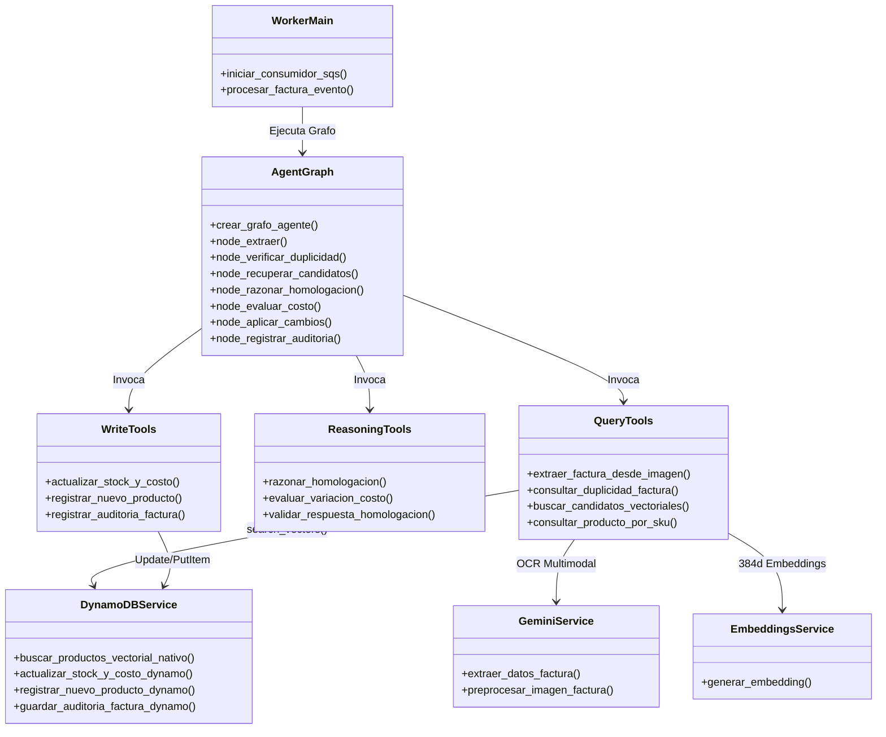

# Agente Inteligente de Homologación de Facturas e Inventario (AWS Cloud)

Sistema de inteligencia artificial distribuido, escalable y resiliente desarrollado bajo una **Arquitectura de Microservicios Orientada a Eventos (Event-Driven)** en **Amazon Web Services (AWS)**. Automatiza la ingesta, extracción multimodal, homologación semántica con **Búsqueda Vectorial Nativa en Amazon DynamoDB** y actualización transaccional del inventario de botillerías a partir de facturas de distribuidores de licores en Chile.

---

## 1. Problema de Negocio y Solución Arquitectónica

En las botillerías y comercializadoras de licores chilenas, las facturas mayoristas presentan glosas informales con abreviaturas complejas (ej. `"mst 35 750"`, `"cerv cor 355 pack6"`, `"pis cap 30"`), formatos por bulto/pack y alzas de precios imprevistas.

* **El Problema del Monolito:** En arquitecturas monolíticas previas, la ingesta HTTP y el cómputo pesado de inferencia de IA (OCR con Gemini, embeddings y LangGraph) competían por el mismo proceso, provocando saturación de memoria, hilos bloqueados y caídas por *HTTP Gateway Timeout* (504).
* **Nuestra Solución en AWS:**
  * **Microservicio API (`api/`):** Ligero, I/O Bound (~100-120 MB RAM), expone `/health` y `POST /facturas/upload` retornando inmediatamente **HTTP 202 Accepted**.
  * **Almacenamiento de Objetos (`Amazon S3`):** Almacena las imágenes crudas de las facturas de forma durable y segura.
  * **Cola de Mensajería Asíncrona (`Amazon SQS`):** Desacopla la recepción del procesamiento y absorbe picos de demanda con tolerancia a fallos.
  * **Microservicio Worker (`worker/`):** Consumidor asíncrono con **Long Polling**, orquestado mediante **LangGraph**, **Búsqueda Vectorial Nativa en DynamoDB (`search_vectors`)** y diseño **Stateless** (limpieza en `/tmp/`).

---

## 2. Arquitectura General del Sistema en AWS

```mermaid
flowchart TD
    Cliente([Cliente / Operador de Botillería]) -->|POST /facturas/upload\nGET /health| ALB[Application Load Balancer / Ingress]

    subgraph ECS_Cluster ["Amazon ECS Cluster (Fargate / EC2)"]
        subgraph Microservicio_API ["Microservicio API (FastAPI)"]
            ALB -->|Petición HTTP| C_API["Contenedor API\n(python:3.11-slim)\n~100-120 MB RAM"]
        end

        subgraph Microservicio_Worker ["Microservicio Worker (LangGraph AI)"]
            C_Worker["Contenedor Worker\n(python:3.11-slim)\n~300-380 MB RAM"]
        end
    end

    subgraph AWS_Cloud_Services ["Servicios Gestionados AWS"]
        S3[("Amazon S3 Bucket\n'botilleria-facturas-raw'")]
        SQS[("Amazon SQS Queue\n'botilleria-facturas-queue'")]
        DDB_Prod[("Amazon DynamoDB: 'botilleria-productos'\n• VectorIndexes (384d, COSINE)\n• Actualización Atómica ADD")]
        DDB_Audit[("Amazon DynamoDB: 'botilleria-historial-facturas'\n• Auditoría Transaccional")]
        CloudWatch[("Amazon CloudWatch Logs\n• Structured JSON Logging")]
    end

    subgraph AI_Inference ["Servicios Externos de Inteligencia"]
        Gemini["Google Gemini Vision API\n(OCR Multimodal)"]
        LLM["Groq / OpenAI API\n(Razonamiento Homologación)"]
    end

    %% Flujos de Ingesta
    C_API -->|1. PutObject (Guarda Imagen)| S3
    C_API -->|2. SendMessage (factura_id, s3_key)| SQS
    C_API -->|3. HTTP 202 Accepted| Cliente

    %% Flujos del Worker
    C_Worker -->|4. Long Polling (WaitTime=20s)| SQS
    C_Worker -->|5. GetObject temporal a /tmp/| S3
    C_Worker -->|6. Percepción Multimodal| Gemini
    C_Worker -->|7. Búsqueda Vectorial Nativa search_vectors()| DDB_Prod
    C_Worker -->|8. Razonamiento Semántico con Pydantic| LLM
    C_Worker -->|9. Actualización Atómica de Stock| DDB_Prod
    C_Worker -->|10. Registro de Auditoría| DDB_Audit
    C_Worker -->|11. Borrado de archivo en /tmp/ (Stateless)| C_Worker
    C_Worker -->|12. delete_message() tras Éxito (ACK)| SQS

    %% Trazabilidad
    C_API -.->|Métricas y Errores| CloudWatch
    C_Worker -.->|Tiempos de Ejecución| CloudWatch
```

---

## 3. Justificación de Patrones Arquitectónicos

### Patrón 1: Arquitectura de Microservicios
* **Separación Estricta de Cómputo:** El servicio `api/main.py` no importa ninguna librería de IA (`langgraph`, `gemini`, `sentence-transformers`). Su único propósito es la ingesta segura y rápida.
* **Escalado Asimétrico:** La API puede escalar a decenas de réplicas en segundos con un consumo despreciable de memoria, mientras que los Workers escalan independientemente según la profundidad de la cola SQS (`ApproximateNumberOfMessagesVisible`).

### Patrón 2: Arquitectura Orientada a Eventos (Event-Driven con SQS y S3)
* **Desacoplamiento Temporal (HTTP 202 Accepted):** El cliente recibe de inmediato su identificador de seguimiento `factura_id` sin esperar los 15-30 segundos que demora el análisis multimodal y semántico.
* **Tolerancia a Fallos y ACK Diferido:** El Worker realiza **Long Polling** (`WaitTimeSeconds=20`). El mensaje no se elimina de la cola hasta que el grafo de LangGraph finaliza completamente. Si un contenedor se detiene a mitad del proceso, el *Visibility Timeout* expira y otra réplica retoma el procesamiento sin pérdida de datos.

### Patrón 3: Búsqueda Vectorial Nativa en Amazon DynamoDB
* **Sin clústeres externos:** Aprovecha la capacidad oficial de **Vector Search en DynamoDB** (Disponibilidad General, 5 de agosto de 2026).
* Al crear la tabla `botilleria-productos`, se define el bloque `VectorIndexes`:
  ```python
  VectorIndexes=[{
      "IndexName": "ProductosVectorIndex",
      "VectorAttribute": {"AttributeName": "embedding"},
      "Dimensions": 384,
      "DistanceFunction": "COSINE",
      "Projection": {"ProjectionType": "ALL"}
  }]
  ```
* La búsqueda se realiza directamente en la nube de AWS mediante `dynamodb.search_vectors()`, garantizando latencias mínimas y costo $0$ en servidores dedicados.

---

## 4. Diagrama de Componentes del Worker (`worker/src/`)



---

## 5. Estructura del Repositorio

```text
agente_facturas_botilleria_AWS/
├── api/                                # Microservicio de Ingesta Web
│   ├── Dockerfile                      # python:3.11-slim (~120 MB RAM) con Health Check
│   ├── requirements.txt                # Dependencias livianas (FastAPI, Boto3)
│   ├── config.py                       # Gestión de clientes S3 y SQS
│   └── main.py                         # Endpoints: GET /health y POST /facturas/upload
│
├── worker/                             # Microservicio de Procesamiento con IA
│   ├── Dockerfile                      # python:3.11-slim optimizado para LangGraph
│   ├── requirements.txt                # Dependencias de IA (LangGraph, Gemini, Boto3)
│   ├── config.py                       # Configuración DynamoDB y modelos de lenguaje
│   ├── main.py                         # Bucle SQS Long Polling (20s) y diseño Stateless
│   └── src/                            # Componentes modulares del agente
│       ├── agent/
│       │   ├── state.py                # AgentState tipado
│       │   └── graph.py                # Grafo de estados finitos LangGraph (10 nodos)
│       ├── services/
│       │   ├── dynamodb.py             # Adaptador AWS DynamoDB (VectorIndexes nativo)
│       │   ├── gemini.py               # Percepción multimodal con Gemini Vision
│       │   ├── embeddings.py           # SentenceTransformers (384 dimensiones)
│       │   ├── llm.py                  # Cliente LLM para razonamiento (Groq/OpenAI)
│       │   ├── seed.py                 # Script de siembra e indexación vectorial
│       │   └── seed_data.json          # Catálogo inicial de 40 productos
│       └── tools/
│           ├── query_tools.py          # Búsqueda vectorial nativa y consultas
│           ├── reasoning_tools.py      # Validación Pydantic y análisis de costos
│           └── write_tools.py          # Actualizaciones atómicas e idempotentes
│
├── data/                               # Facturas locales de prueba
│   └── factura1.png
├── docker-compose.yml                  # Orquestador multi-contenedor local
├── main.py                             # CLI interactiva para administración local
├── .env.example                        # Plantilla de variables de entorno y credenciales
└── README.md                           # Documentación técnica del proyecto
```

---

## 6. Despliegue Local con Docker y Medición con `docker stats`

### 1. Configurar Variables de Entorno
Copia la plantilla y configura tus credenciales de AWS y claves de IA:
```bash
cp .env.example .env
```

### 2. Construir y Levantar los Microservicios
```bash
docker compose up --build -d
```

### 3. Medición Cuantitativa de Recursos en Tiempo Real
Para recopilar la evidencia de consumo de RAM y CPU para el informe técnico:
```bash
docker stats
```

**Consumos esperados de referencia:**
* **`botilleria_api`:** $\approx 100\text{ MB} - 120\text{ MB}$ RAM | $<1\%$ CPU en reposo.
* **`botilleria_worker`:** $\approx 300\text{ MB} - 380\text{ MB}$ RAM | Inferencia eficiente en CPU.

### 4. Probar Sondas de Salud (Health Check)
```bash
curl -i http://localhost:8000/health
```
*Respuesta:* `HTTP/1.1 200 OK` $\rightarrow$ `{"status":"ok","service":"api-ingesta",...}`

### 5. Enviar una Factura de Prueba (Asíncrono)
```bash
curl -i -X POST http://localhost:8000/facturas/upload \
     -F "file=@data/factura1.png"
```
*Respuesta Inmediata:* `HTTP/1.1 202 Accepted` $\rightarrow$ `{"factura_id":"...","status":"ACEPTADO"}`

### 6. Inspeccionar Logs Estructurados en CloudWatch / Docker
```bash
docker logs -f botilleria_worker
```
Observarás la recepción del evento SQS, la descarga temporal a `/tmp/`, la ejecución del grafo LangGraph, la persistencia en DynamoDB, el tiempo total de procesamiento y la eliminación del archivo temporal.
